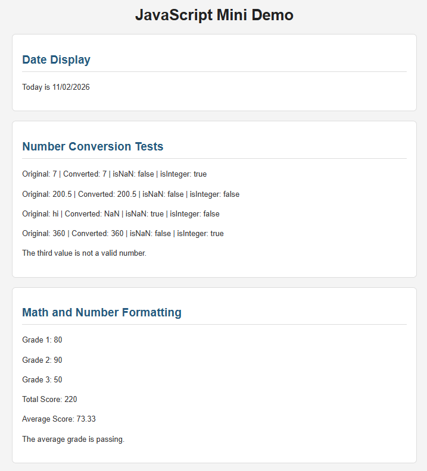

# 1. JavaScript Built-In Objects and Methods Used

### Date Object
- **new Date()** - gets the current date.
- **getMonth()** - gets the current month.
- **getDate()** - gets the current day.
- **getFullYear()** - gets the current year.

### Number Object
- **Number()** - converts a value into a number.
- **Number.isNaN()** - checks if a value is NaN.
- **Number.isInteger()** - checks if a value is a whole number.
- **toFixed(2)** - displays the average grade with two decimal places.

### Other Features Used
- **if/else** - displays different messages depending on the results.
- **document.getElementById()** - finds an HTML element using its ID.
- **innerHTML** and **textContent** - display the JavaScript results on the webpage.

# 2. GitHub Link: 

https://leourq.github.io/comp484-hw9-lzu/

# 3. Screenshot: 

# 4. Reflection:

The easiest part of this homework was the grade calculation because I had to only add the grades for the total grade and divide to get the average grade. I would say the hardest/confusing part was figuring out how to display the result on the webpage, because I would confuse myself when using HTML tags like "p" inside JavaScript. I learned that the Date object gets the current date, but I had to add 1 to the month because JS starts counting from 0. The Number object helped me understand how to convert strings into numbers and check if they are valid. I also learned how innerHTML and textContent can display JS results directly on the webpage.
